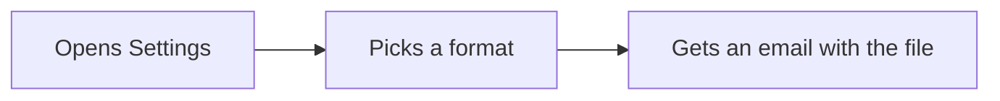

# Templates: docs

For the types in [kinds/docs](../reference/kinds/docs.md). Start from the frontmatter plus the body for the type. Replace every `<…>`; check and lint flag what's left. Delete a section that has nothing true to say instead of filling it.

## Frontmatter

```yaml
---
type: <type from kinds/docs.md>
title: <title in a few words>
description: <the most useful fact about it, in one sentence>
scope: <acme-api/area>
specificity: <general, specific or exact>
credibility: <reported or inferred>
generated:
  by: <agent ACTOR>
  at: <NOW>
sources:
  - id: <short id>
    resource: <../../src/path/file.ts>
---
```

Leave out `scope` when it is the bundle's root scope. Add `resource` with the canonical URI for an api or schema file. Each key is explained in [format](../reference/format.md).

## concept

```markdown
# <feature name>

<One or two lines: what it does, for whom, and the main limit.>

## Behavior

<Rules or steps with exact values: limits, defaults, timeouts, who may do it.>[^<short id>]

## Constraints

<Edge cases and failure modes, each with its error or result.>

## Related

- [<related file title>](<relative/path.md>)

[^<short id>]: <src/path/file.ts>
```

## design

````markdown
# <flow or component name>

<One or two lines: what the user gets done with it.>

## Flow



<What the user sees and does at each step, with UI labels exactly as on screen.>

## States

| State | Shown when | The user can |
|---|---|---|
| <state name> | <condition that shows it> | <actions available> |

## Constraints

<Accessibility, platform and performance requirements; what is out of scope.>

## Related

- [<related file title>](<relative/path.md>)
````

## api

````markdown
# <method and path, or event name>

<One line: what it does and who may call it.>

| Property | Value |
|---|---|
| Endpoint | `<POST /v1/exports>` |
| Auth | <scope or role required> |
| Rate limit | <requests per minute, per key> |
| Idempotency | <how retries are made safe, or "not idempotent"> |

## Request

| Field | Type | Required | Notes |
|---|---|---|---|
| `<field name>` | <field type> | <yes or no> | <default, limits, allowed values> |

## Response

<Status codes, then the body fields in a table like the request.>

## Errors

| Code | When | What the caller does |
|---|---|---|
| `<ERROR_CODE>` | <condition that causes it> | <fix, or when to retry> |

## Example

```http
<example request and response>
```

## Related

- [<related file title>](<relative/path.md>)
````

## schema

```markdown
# <table or model name>

<One line: what a record represents and what writes it.>

## Fields

| Field | Type | Null | Default | Notes |
|---|---|---|---|---|
| `<column name>` | <column type> | <yes or no> | <default value> | <meaning, allowed values, index> |

## Invariants

- <a rule that always holds, such as "one running export per workspace">

## Migrations

| Date | Change | Migration |
|---|---|---|
| <date, YYYY-MM-DD> | <what changed> | `<migrations/0042_add_format.sql>` |

## Related

- [<related file title>](<relative/path.md>)
```

## convention

````markdown
# <the rule in a few words>

<The rule as one imperative sentence.>

## Why

<The reason, or a link to the decision it comes from.>

## Examples

Follows the rule:

```<language>
<code that follows it>
```

Breaks it:

```<language>
<code that breaks it>
```

## Exceptions

<When the rule doesn't apply, or "None.">
````

## security

Describe controls; never paste secrets, keys or credentials.

```markdown
# <control or area>

<One line: what is protected, from whom, and how.>

## Threats

| Threat | Impact | Control |
|---|---|---|
| <what could happen> | <who or what is harmed> | <what prevents or detects it> |

## Controls

<How each control is implemented, citing the code or config that does it.>[^<short id>]

## Data handled

| Data | Classification | Where stored | Retention |
|---|---|---|---|
| <kind of data> | <public, internal, confidential or restricted> | <location and encryption> | <how long> |

## Related

- [<related file title>](<relative/path.md>)
```

## runbook

````markdown
# <the task, as a verb phrase>

<When to use it, in one line, and how long it takes.>

## Before you start

- <access, tool or approval needed>

## Steps

1. <One action, with its exact command.>

   ```bash
   <exact command>
   ```

2. <Next action.>

## Verify

<The command and its expected output, or the dashboard and what it shows when it worked.>

## Roll back

1. <One action per step.>

## Escalation

<Who to contact, as a role or channel, and when.>
````

## decision

Add `supersedes: <NNN-old-title.md>` to the frontmatter when it replaces an earlier decision. Record only the rationale and alternatives that were stated; otherwise write "Not recorded."

```markdown
# <NNN>. <the decision in a few words>

<Date decided, YYYY-MM-DD>, by <role or human id>.

## Context

<The problem and the constraints at the time.>

## Decision

<What was chosen, in one or two sentences.>

## Rationale

<The reasons given, or "Not recorded.">

## Alternatives considered

<Each option and why it lost, as stated, or "Not recorded.">

## Consequences

<What this makes easier and harder; follow-up work.>

## Affected

- [<affected file title>](<relative/path.md>)
```
